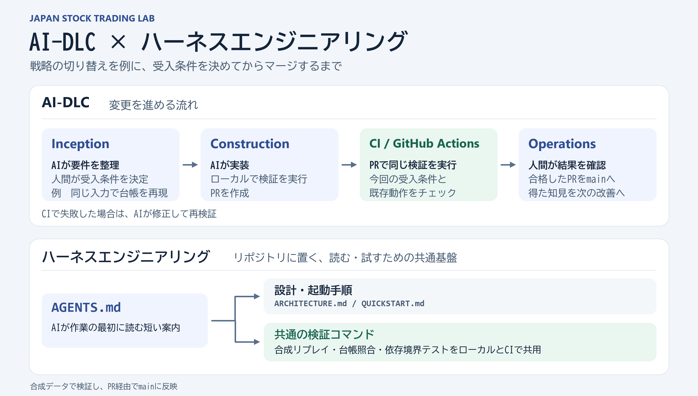

# Japan Stock Trading Lab

日本株の市場データ処理とペーパー取引を検証するプロジェクトです。**Go** ではデータ収集、戦略判断、仮想約定、数量台帳の照合を扱います。**Python** では、2分足MACDの計算とバックテストを合成データで検証します。

## 利用する外部サービス

| 接続先 | このプロジェクトでの用途 |
| --- | --- |
| [J-Quants API](https://jpx-jquants.com/ja/help/about) | 研究・バックテスト用の過去の分足・日足、銘柄マスター、取引カレンダーの取得 |
| [kabuステーション®API](https://kabu.com/item/kabustation_api/default.html)（三菱UFJ eスマート証券） | Windows上のkabuステーションから板・歩み値を収集し、余力・残高・建玉を読み取りで照会 |

実データを取得する場合は、使う接続先のアカウントとAPI設定が必要です。公開版のkabu接続は読み取り用です。合成デモとテストはどちらのサービスにも接続せずに動かせます。

## 試す

### Goでペーパー取引を再生する

Go 1.26 以上を用意し、リポジトリのルートで実行します。

```sh
go run ./cmd/kabu-research session-demo -direction long -variant A
go run ./cmd/kabu-research paper-demo
go test ./...
go vet ./...
```

セッションデモでは、部分約定、期限切れ、データ途絶、時計の逆行など8ケースを実行します。`passed=true` は期待した状態との一致を示します。たとえば入力が途絶えたケースでは、残った仮想ポジションを台帳に保持して停止します。デモ結果はローカルの `data/research/` に出力されます。

### Pythonでバックテストを検証する

Python 3.12で確認しています。標準ライブラリだけで、MACDの計算、分足の集約、売買費用や欠損時の扱いを合成テストで検証できます。

```sh
python -B -m unittest discover -s research/python -t research/python -v
```

入力はテスト内で生成します。GoとPythonはそれぞれ単独で実行できます。

## 構成

| 領域 | 主な役割 |
| --- | --- |
| [市場データ](internal/marketdata) | 価格・数量・時刻の型、分足や気配の正規化 |
| [入力ゲート](internal/features/streamsignals) | 確定足の受理、重複判定、入力待ちの期限 |
| [戦略](internal/strategy) | 入力された足からの判断 |
| [ペーパー取引](internal/features/papertrade) | 新しい気配を使った仮想約定、数量台帳と復元 |
| [記録と照合](internal/paperrecordingv3) | サイズ上限を持つイベント記録と、検証できた範囲の読み戻し |
| [起動CLI](cmd) | オフライン研究、読み取り収集、ローカル表示の組み立て |
| [Pythonの研究コード](research/python/macd_backtest) | 2分足MACD、模擬バックテスト、別実装による計算の照合 |

詳しい流れは [アーキテクチャ](docs/ARCHITECTURE.md) と [起動手順](docs/QUICKSTART.md) にあります。

## 開発フロー

AI-DLCで合意した受入条件を、ローカルとGitHub Actionsで共通の検証につなげます。



コードと合成テストを公開しています。利用者が取得した市場データや運用記録は各自のローカル環境で扱います。プロジェクトのソースコードにはオープンソースライセンスを付与しておらず、権利は権利者に留保されます。GitHub上での閲覧・フォークにはGitHubの利用規約が適用されます。
