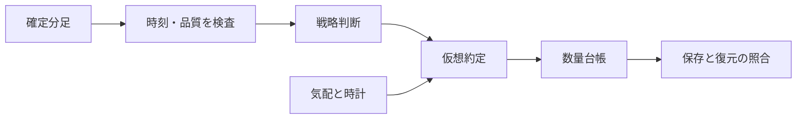

# アーキテクチャ

起動CLIが、データの受け取り方と各処理を組み立てます。戦略は公開型の市場データを受け取り、判断を返す役割です。

- 戦略判断は確定時刻までに得た足を使います。仮想約定では、注文意図より後の気配の時刻と表示数量を検査します。
- 入力途絶や受付不明はそれぞれ状態として残します。未解消の仮想数量が残る場合は、その数量を確認できる形で止めます。
- 数量台帳のチェックポイントはペーパー取引の復元に使います。分割イベント記録器は別の部品で、入力ごとにハッシュをつなぎ、破損や途中終了時は検証できた範囲を返します。
- 外部接続の組み立ては `cmd` が担当します。依存境界は `internal/architecture` のテストで確認します。

公開版で確認できるのは、合成シナリオに対する実装と再現性です。市場での収益や実約定は別の評価になります。
