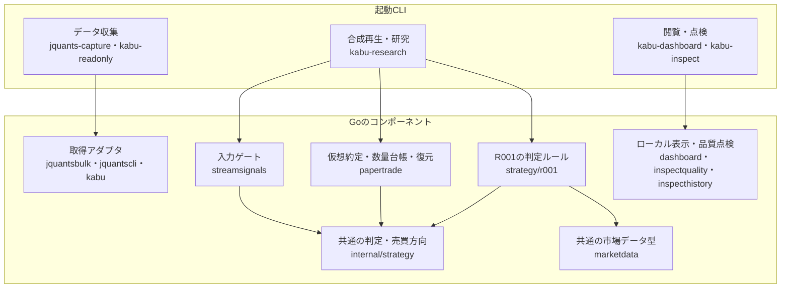
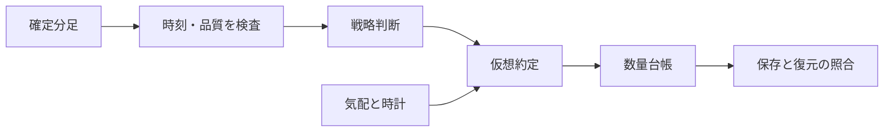

# アーキテクチャ

## コンポーネント構成

公開版の主なGoコンポーネントを合成セッションの経路を中心に示します。矢印は、呼び出す側から利用する側に向いています。

| 境界 | 受け渡し・責務 |
| --- | --- |
| 外部データ | 取得アダプタがJ-Quantsまたはkabuステーションへ接続し、収集CLIが取得結果をローカルに保存します。 |
| ローカルの入力と結果 | 研究CLIは組み込みの合成入力や保存済みデータを使い、再生結果を保存します。閲覧・点検CLIは保存された観測結果を参照します。 |
| 分割イベント記録 | [paperrecordingv3](../../internal/paperrecordingv3)は、イベントをハッシュでつないで保存し、破損や途中終了時には再読込できた範囲を返します。 |
| Pythonの研究 | [MACDバックテスト](../../research/python/macd_backtest)は、合成分足、シグナル、仮想売買の計算をPythonで再現します。 |

合成 `session-demo` では、起動CLIがR001の参入判定を入力ゲートへ、退出判定をペーパーセッションへ渡します。戦略は確定足や観測時刻から判断し、仮想約定の価格と数量、台帳と復元は `papertrade` が担当します。

## ペーパー取引の処理フロー

- 戦略判断は確定時刻までに得た足を使います。仮想約定では、注文意図より後の気配の時刻と表示数量を検査します。
- 入力途絶や受付不明はそれぞれ状態として残します。未解消の仮想数量が残る場合は、その数量を確認できる形で止めます。
- 数量台帳のチェックポイントはペーパー取引の復元に使います。
- 外部接続の組み立ては `cmd` が担当します。依存境界は `internal/architecture` のテストで確認します。

公開版で確認できるのは、合成シナリオに対する実装と再現性です。市場での収益や実約定は別の評価になります。
