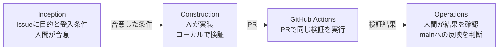
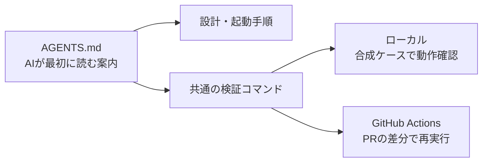

# 開発フロー

AI-DLCで決めた受入条件を、ローカルとCIで再実行できる検証につなげます。たとえば戦略を切り替える変更なら、「同じ合成入力と設定で再実行したとき、仮想約定と台帳の最終状態を再現できる」と定め、PRから検証結果を確認します。

## AI-DLCの流れ

- **Inception**では、動作や設計を変えるときにGitHub Issueへ目的、変更範囲、受入条件、検証方法を記録します。人間と合意した内容や、後から条件を変えた理由も同じIssueに残します。誤字修正など、受入条件が自明な変更はPRの説明だけで進められます。
- **Construction**では、AIが変更を実装し、受入条件に対応する検証を実行します。PRからIssueにリンクし、各条件の確認結果、Actionsの結果、未確認の項目を記録します。対応が完了するPRでは `Closes #番号` を使うと、`main` へのマージ時にIssueも閉じます。
- **Operations**では、人間が差分とPRの検証結果を見てマージを判断します。マージ後は `main` のCIで統合後も検証が通ることを確認します。作業中に見つかった改善は、再現できる合成テスト、参照する文書、次のIssueのうち、再利用しやすい形で残します。

[Inceptionテンプレート](../../.github/ISSUE_TEMPLATE/inception.md)では、人間が最初に読む箇所に判断事項と提案を置きます。関係や順番が判断に影響するときは短い図を添え、受入条件は「場面・期待する結果・確かめ方」の表にします。設計や検証の詳細は折りたたみに置きます。

CIで失敗した場合は、失敗した条件をAIが読み取り、修正後に同じ検証を再実行します。

合成セッションの残数量を表示する変更では、[Issue #3](https://github.com/kiraemon/japan-stock-trading-lab/issues/3)で正常終了・気配途絶・台帳との一致を受入条件に定め、[PR #4](https://github.com/kiraemon/japan-stock-trading-lab/pull/4)に各条件の検証結果を記録しました。利用時に参照する表示項目の意味は[コマンドリファレンス](../reference/verification-commands.md)に記載します。

## ハーネスとCIの接点

`AGENTS.md` は、リポジトリの制約、設計の参照先、検証方法への短い入口です。[アーキテクチャ](architecture.md)が処理の境界を説明し、[検証手順](../how-to/verify-locally.md)が合成リプレイ、数量台帳の照合、依存境界テストの実行方法を案内します。

GitHub Actionsでは、ローカルと同じ検証をPRに対して実行し、受入条件と既存動作を確かめます。検証には合成データを使います。CIの結果は、人間が変更を判断するための材料になります。

[`AGENTS.md`](../../AGENTS.md)から設計と検証手順を参照できます。[検証ワークフロー](../../.github/workflows/verify.yml)は、PRと`main`への反映後に共通の検証コマンドを実行します。

[ドキュメント一覧](../README.md)
