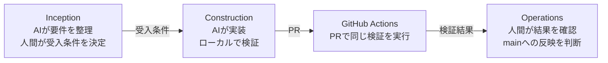
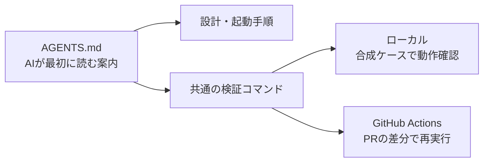

# 開発フロー

AI-DLCで決めた受入条件を、ローカルとCIで再実行できる検証につなげます。たとえば戦略を切り替える変更なら、「同じ合成入力と設定で再実行したとき、仮想約定と台帳の最終状態を再現できる」と定め、PRから検証結果を確認します。

## AI-DLCの流れ

- **Inception**では、目的、変更範囲、期待する結果を明確にします。合成ケースと確認する結果を決めておくと、PRでその条件を直接検証できます。
- **Construction**では、AIが変更を実装し、受入条件に対応する検証を実行します。PRに変更理由、確認結果、未確認の項目を残します。
- **Operations**では、人間が差分と検証結果を見てマージを判断します。再発した問題は、次回も再現できる合成テストや設計上のルールに反映します。

CIで失敗した場合は、失敗した条件をAIが読み取り、修正後に同じ検証を再実行します。

## ハーネスとCIの接点

`AGENTS.md` は、リポジトリの制約、設計の参照先、検証方法への短い入口です。[アーキテクチャ](architecture.md)が処理の境界を説明し、[検証手順](../how-to/verify-locally.md)が合成リプレイ、数量台帳の照合、依存境界テストの実行方法を案内します。

GitHub Actionsでは、ローカルと同じ検証をPRに対して実行し、受入条件と既存動作を確かめます。検証には合成データを使います。CIの結果は、人間が変更を判断するための材料になります。

現在は、合成デモとローカル検証を実行できます。公開版の `AGENTS.md` とGitHub Actionsのワークフローは、この方針に沿って追加します。

[ドキュメント一覧](../README.md)
